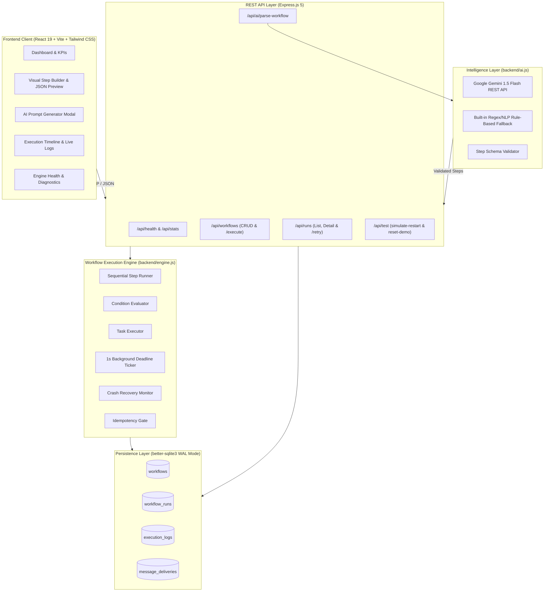
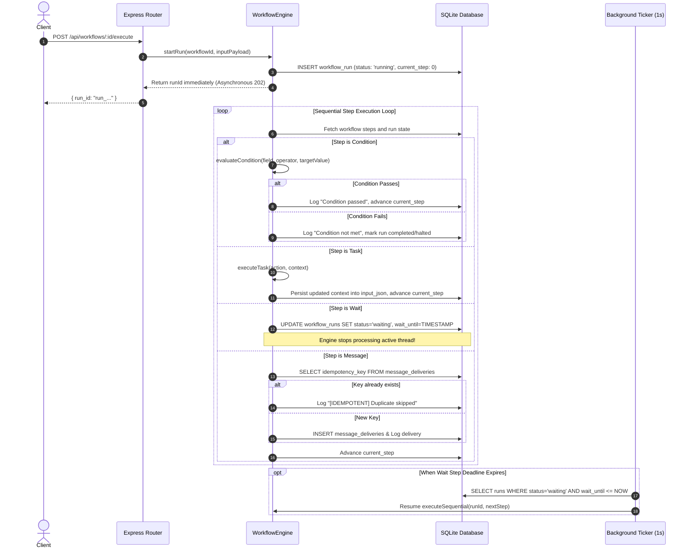
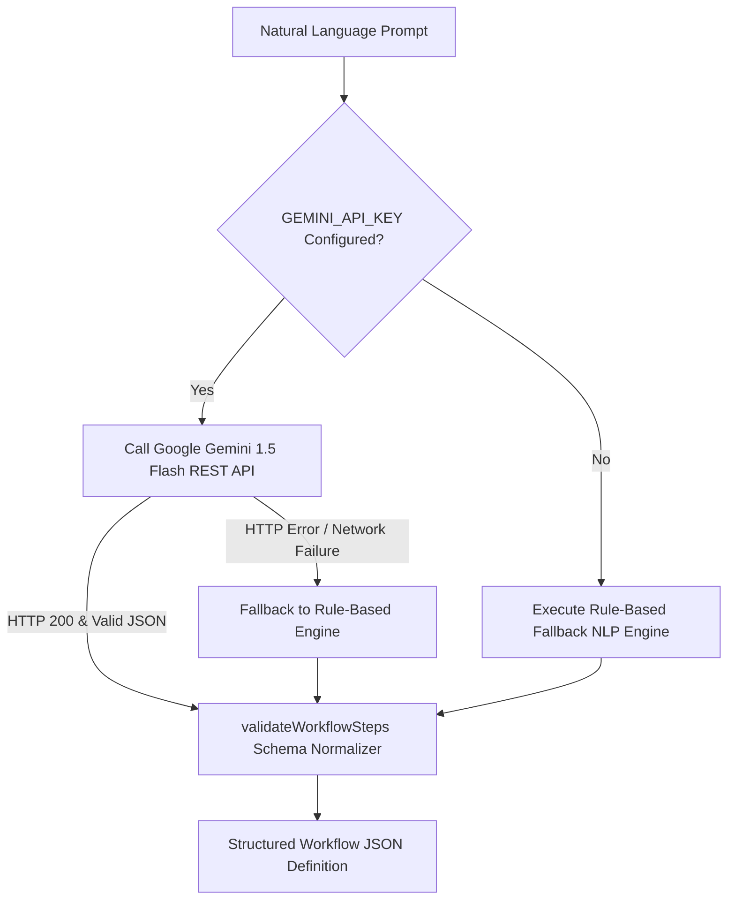
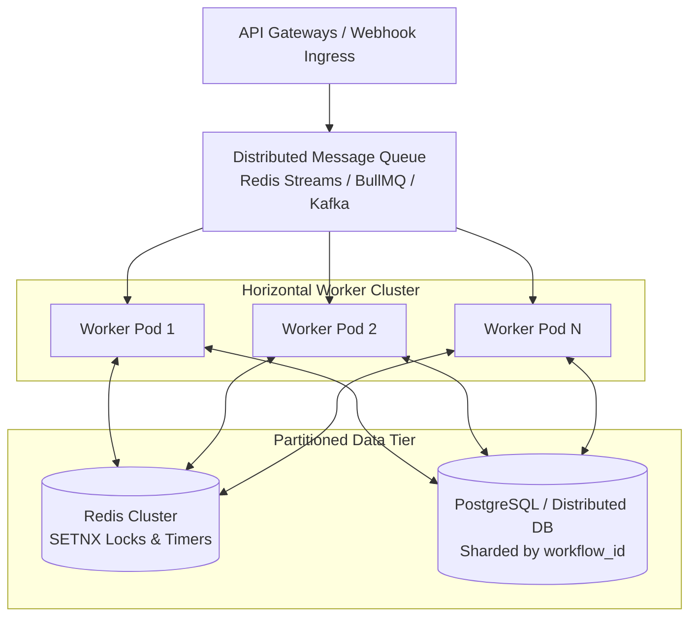

# FlowAI - Comprehensive System Architecture & Implementation Analysis

---

## 1. Executive Summary: What is FlowAI?

**FlowAI** is a resilient, enterprise-grade **AI workflow automation and orchestration platform**. It allows businesses and developers to design, compile, and execute sequential, conditional, asynchronous, and idempotent multi-step workflows.

### 1.1 The Problems FlowAI Solves
Traditional workflow engines and custom webhook scripts frequently suffer from:
1. **Volatile Memory Fragility**: If the server crashes or restarts during a workflow execution or wait delay, all running tasks and state pointers are permanently lost.
2. **Resource Exhaustion on Delays**: Naive implementations use active CPU threads or in-memory timers (e.g., `setTimeout`, `sleep()`) to pause executions. This saturates server memory and collapses when scaling to thousands of delayed tasks.
3. **Duplicate Outbound Actions**: Retrying failed operations or experiencing rapid webhook triggers leads to duplicate message dispatches, multiple emails, or double billing.
4. **Friction in Workflow Authoring**: Constructing structured multi-step automation logic usually requires either writing custom code or navigating complex, disjointed interfaces.

### 1.2 The FlowAI Solution
FlowAI eliminates these problems with an architecture built around:
- **Durable Step Checkpointing**: Every workflow run and step transition is committed to an embedded SQLite database in WAL (Write-Ahead Logging) mode.
- **Non-Blocking Asynchronous Wait Timers**: Wait steps calculate an indexed ISO deadline (`wait_until`) stored in SQLite. No active threads or memory timers are held.
- **Automatic Crash Recovery**: On boot or simulated crash restart, the engine scans for interrupted runs and expired wait timers, automatically resuming them from their last checkpointed step.
- **Strict Idempotency Protection**: Every message dispatch enforces a deterministic idempotency key (`${run_id}_step_${step_index}`) backed by database transactions and unique constraints.
- **Dual-Mode AI Workflow Generation**: Users can generate complex workflows by describing them in plain English. The platform compiles them using **Google Gemini 1.5 Flash**, with automatic fallback to an offline **Rule-Based NLP Engine** if no API key is configured.
- **Observability Dashboard**: A modern React 19 / Tailwind CSS dashboard provides real-time monitoring with step timelines, live execution logs, and an interactive step builder.

---

## 2. High-Level System Architecture



---

## 3. Technology Stack & Technical Rationale

| Layer | Technology | Version | Purpose & Architecture Rationale |
|---|---|---|---|
| **Frontend Framework** | **React** | `19.0.0` | Declarative UI rendering, fast virtual DOM, and component composition. |
| **Frontend Tooling** | **Vite** | `6.0.7` | Sub-millisecond HMR (Hot Module Replacement) and optimized production bundling. |
| **Styling** | **Tailwind CSS** | `3.4.17` | Utility-first responsive CSS styling with clean SaaS color palette. |
| **Icons** | **Lucide React** | `1.16.0` | Consistent, accessible iconography across pages and step types. |
| **Backend Framework** | **Node.js / Express** | `5.3.0` | Asynchronous event-driven REST API server with modern route handling. |
| **Database** | **SQLite** (`better-sqlite3`) | `13.2.0` | High-performance synchronous SQLite client configured in **WAL Mode** for concurrent read/write throughput without network overhead. |
| **AI LLM** | **Google Gemini 1.5 Flash** | v1beta REST | High-speed structured JSON compilation from natural language prompts. |
| **Rule-based NLP** | Native JavaScript | ES Modules | Fallback pattern matching engine for offline or unconfigured environments. |
| **Process Runner** | **concurrently** | `10.0.7` | Unified local execution running both backend and client concurrently. |

---

## 4. Implementation Deep Dive

### 4.1 Database Architecture & Schema Design (`backend/db.js`)

FlowAI uses `better-sqlite3` initialized with Write-Ahead Logging (`WAL`) mode and foreign key enforcement enabled:
```javascript
db.pragma('journal_mode = WAL');
db.pragma('foreign_keys = ON');
```

The database consists of 4 relational tables:

```
┌─────────────────┐       ┌─────────────────────┐
│    workflows    │1     *│    workflow_runs    │
├─────────────────┤───────├─────────────────────┤
│ id (PK)         │       │ id (PK)             │
│ name            │       │ workflow_id (FK)    │
│ description     │       │ status              │
│ trigger_config  │       │ current_step        │
│ steps_json      │       │ input_json          │
│ status          │       │ wait_until          │
│ created_at      │       │ created_at          │
│ updated_at      │       │ updated_at          │
└─────────────────┘       └──────────┬──────────┘
                                     │ 1
                                     ├────────────────────────┐
                                     │ *                      │ *
                         ┌───────────┴──────────┐ ┌───────────┴───────────┐
                         │    execution_logs    │ │   message_deliveries  │
                         ├──────────────────────┤ ├───────────────────────┤
                         │ id (PK, AutoInc)     │ │ id (PK, AutoInc)      │
                         │ run_id (FK)          │ │ run_id (FK)           │
                         │ step_index           │ │ idempotency_key (UQ)  │
                         │ status               │ │ message               │
                         │ message              │ │ status                │
                         │ created_at           │ │ created_at            │
                         └──────────────────────┘ └───────────────────────┘
```

#### Table Specifications:
1. **`workflows`**: Holds workflow definitions, metadata, JSON-encoded trigger configurations, step sequences, and active/inactive state.
2. **`workflow_runs`**: Represents an execution instance of a workflow. Tracks overall status (`running`, `waiting`, `completed`, `failed`), `current_step` index, run payload context (`input_json`), and deadline timestamp (`wait_until`).
3. **`execution_logs`**: Step-level immutable audit trail capturing step index, log level/status (`info`, `running`, `waiting`, `completed`, `failed`), human-readable messages, and timestamps.
4. **`message_deliveries`**: Tracks outbound simulated messages. Contains a `UNIQUE` index on `idempotency_key` ensuring zero duplicate dispatches.

#### Indexes:
- `idx_workflow_runs_status`: Optimizes filtering by status.
- `idx_workflow_runs_wait_until`: Enables fast index scans for expired deadlines.
- `idx_execution_logs_run_id`: Fast retrieval of execution timelines for individual runs.
- `idx_message_deliveries_key`: Instant lookups for duplicate suppression.

---

### 4.2 The Workflow Execution Engine (`backend/engine.js`)

The `WorkflowEngine` class orchestrates step progression, condition evaluations, task actions, asynchronous waiting, crash recovery, and idempotency.



#### Step Type Implementation Details:

1. **`condition` Evaluation**:
   - Safely retrieves nested fields from the input context (e.g., `amount` or `order.customer.tier`) using `getFieldValue()`.
   - Supports numeric and string operators: `greater_than` (`>`), `greater_than_or_equal` (`>=`), `less_than` (`<`), `less_than_or_equal` (`<=`), `equals` (`==`), `not_equals` (`!=`), and `contains`.
   - If the condition passes, it logs success and proceeds. If it fails, it logs diagnostic details and cleanly halts execution.

2. **`task` Execution**:
   - Executes computational actions:
     - `calculate_discount`: Computes customer discount rate, calculates the deduction, and generates an authorization code.
     - `generate_invoice`: Produces an automated invoice number and timestamp.
   - Saves task output into the execution context (`context.task_result_X`) and writes the updated JSON back to SQLite for full durability.

3. **`wait` Step (Non-Blocking Asynchronous Persistence)**:
   - Evaluates `duration_seconds` (default: 10s).
   - Computes future ISO timestamp: `new Date(Date.now() + duration * 1000).toISOString()`.
   - Atomically updates the database: `status = 'waiting'`, `current_step = i`, `wait_until = deadline`.
   - **Exits the execution loop**: The Node.js thread is immediately freed.
   - The engine's 1-second interval ticker queries:
     ```sql
     SELECT id, current_step FROM workflow_runs
     WHERE status = 'waiting' AND wait_until IS NOT NULL AND wait_until <= ?
     ```
   - When the deadline passes, the ticker updates `status = 'running'`, sets `current_step = i + 1`, and resumes execution.

4. **`message` Step (Idempotency Enforcement)**:
   - Generates a deterministic key: `${runId}_step_${stepIndex}`.
   - Templatizes placeholders (e.g., `{{amount}}`, `{{customer_name}}`).
   - Runs inside a database transaction:
     ```javascript
     const existing = db.prepare('SELECT id FROM message_deliveries WHERE idempotency_key = ?').get(idempotencyKey);
     if (existing) {
       this.log(runId, stepIndex, 'completed', `[IDEMPOTENT] Duplicate skipped. Key: ${idempotencyKey}`);
       return { duplicate: true };
     }
     db.prepare('INSERT INTO message_deliveries (run_id, idempotency_key, message, status, created_at) VALUES (?, ?, ?, ?, ?)').run(...);
     ```

5. **Server Crash Recovery Lifecycle (`recoverUnfinishedRuns`)**:
   - Executed on engine startup (`engine.start()`) or test simulation:
     - **Interrupted `running` runs**: Queries `status = 'running'` runs and resumes execution from their persisted `current_step`.
     - **Waiting runs**: Queries `status = 'waiting'` runs. If `wait_until <= now` (deadline passed during server downtime), execution resumes immediately; otherwise, it remains in waiting state until the ticker catches it.

---

### 4.3 Dual-Mode AI Workflow Generation (`backend/ai.js`)

FlowAI supports natural language workflow creation through a dual-mode compilation architecture:



#### Mode A: Google Gemini 1.5 Flash
- Sends prompt to `https://generativelanguage.googleapis.com/v1beta/models/gemini-1.5-flash:generateContent?key=${apiKey}`.
- Enforces `temperature: 0.1` and `responseMimeType: "application/json"` with strict system instructions defining the schema.

#### Mode B: Rule-Based Fallback NLP Engine (`parseWithRuleEngine`)
- Operates 100% offline with zero dependencies.
- Analyzes sentence structure via regex:
  - **Triggers**: Identifies `order`, `purchase`, `user signup`, `registration`.
  - **Conditions**: Matches patterns like `if amount is greater than 500` or `score >= 80`.
  - **Tasks**: Detects keywords for `calculate discount` and `generate invoice`.
  - **Waits**: Extracts durations like `wait 10 seconds`, `pause for 5 minutes`.
  - **Messages**: Captures notification text or generates appropriate messages.

#### Step Normalizer (`validateWorkflowSteps`)
- Verifies that all steps have valid types (`trigger`, `condition`, `task`, `wait`, `message`).
- Normalizes IDs, step names, default values, and numerical durations.

---

### 4.4 REST API Specifications (`backend/routes/`)

| Router | Method | Route | Description |
|---|---|---|---|
| `health` | `GET` | `/api/health` | Node.js uptime, SQLite status, AI mode, and memory executions. |
| `health` | `GET` | `/api/stats` | Dashboard metrics: total/active workflows, success rate, recent runs. |
| `health` | `POST` | `/api/test/simulate-restart` | Triggers the crash recovery scan to test resilience. |
| `health` | `POST` | `/api/test/reset-demo` | Restores the pre-seeded "High Value Order Follow-up" workflow. |
| `workflows`| `GET` | `/api/workflows` | Lists all workflows with aggregated run metrics. |
| `workflows`| `POST` | `/api/workflows` | Creates a workflow with validated steps. |
| `workflows`| `GET` | `/api/workflows/:id` | Workflow details and its recent 20 runs. |
| `workflows`| `PUT` | `/api/workflows/:id` | Updates workflow metadata, status, or step pipeline. |
| `workflows`| `DELETE`| `/api/workflows/:id` | Deletes workflow (cascading delete on runs and logs). |
| `workflows`| `POST` | `/api/workflows/:id/execute` | Initiates asynchronous execution with input payload. |
| `runs` | `GET` | `/api/runs` | Queries runs with optional `status` and `workflow_id` filters. |
| `runs` | `GET` | `/api/runs/:id` | Full execution record: steps, audit logs, and message deliveries. |
| `runs` | `POST` | `/api/runs/:id/retry` | Re-executes workflow with the previous run's input payload. |
| `ai` | `POST` | `/api/ai/parse-workflow` | Compiles natural language prompt into structured JSON steps. |

---

### 4.5 Frontend Dashboard & User Interface (`frontend/src/`)

The frontend is a single-page application built with React 19, styled with Tailwind CSS, and organized into 6 views:

1. **Dashboard (`DashboardPage.jsx`)**:
   - Welcome banner with quick-action buttons for manual creation and AI generation.
   - Aggregate metric cards: Total Workflows, Active Workflows, Total Executions, Success Rate.
   - Quick-trigger drawer and recent activity feed.
   - 4-second background polling for live updates.
2. **Workflows Catalog (`WorkflowsPage.jsx`)**:
   - Filterable, searchable list of all saved workflows.
   - Active/inactive toggle switch.
   - Quick-run modal trigger and deletion controls.
3. **Visual Step Builder (`CreateWorkflowPage.jsx` & `StepBuilder.jsx`)**:
   - Interactive pipeline editor supporting dynamic reordering (Up / Down) and deletion.
   - Dedicated editors for each step type (Condition comparator, Task action, Wait duration, Message content).
   - Side-by-side or toggled raw JSON editor for direct code editing.
4. **Execution Timeline & Observability (`ExecutionHistoryPage.jsx` & `ExecutionTimeline.jsx`)**:
   - Step-by-step visual execution progress bar.
   - Terminal-style live execution log viewer.
   - Message Delivery Inspector displaying idempotency keys and delivery status.
   - 1.5-second auto-polling while runs are in `running` or `waiting` states.
5. **AI Workflow Generator Modal (`AiPromptModal.jsx`)**:
   - Interactive dialog with prompt presets.
   - Real-time preview of parsed steps before saving.
   - One-click injection into the Step Builder.
6. **Settings & Diagnostics (`SettingsPage.jsx`)**:
   - Live health status monitor.
   - Simulated server restart button to verify crash recovery in real time.
   - Demo workflow reset button.

---

## 5. Architectural Scalability: Supporting 50,000 Concurrent Workflows

To scale FlowAI from a single-node deployment to handling 50,000+ simultaneous workflows:



1. **Decoupled Distributed Queue (Redis Streams / BullMQ / Kafka)**:
   - Separate the REST API tier from execution workers. Step transitions push jobs to worker queues with heartbeat leases, allowing linear horizontal scaling.
2. **Non-Blocking Distributed Timers (Redis ZSET)**:
   - Store wait deadlines in a Redis Sorted Set (`ZADD wait_deadlines <timestamp> <run_id>`). Dedicated timer workers poll expired deadlines using `ZRANGEBYSCORE` with minimal overhead.
3. **Optimistic Locking on Step State**:
   - Prevent race conditions across competing workers using atomic versioned updates:
     ```sql
     UPDATE workflow_runs 
     SET status = 'running', current_step = :next_step 
     WHERE id = :run_id AND current_step = :expected_step;
     ```
4. **Distributed Idempotency Layer**:
   - Use Redis distributed locks (`SET key val NX EX 300`) for sub-millisecond duplicate suppression on inbound webhooks and outbound dispatches, backed by database constraints.
5. **Database Sharding & Read-Write Segregation**:
   - Shard the operational database by `workflow_id` or `run_id`.
   - Stream historical `execution_logs` to append-only analytical storage (e.g., ClickHouse, BigQuery) to keep operational tables lean.

---

## 6. Automated Testing & Verification Suite

FlowAI includes dedicated verification scripts:

| Test File | Verified Scenarios | Result |
|---|---|---|
| **`backend/test-engine.js`** | 1. Database table initialization<br>2. Rule-based NLP parsing<br>3. End-to-end execution of demo workflow<br>4. Condition pass logic (`amount > 500`)<br>5. Wait step scheduling<br>6. Crash recovery scan execution<br>7. Duplicate message prevention (Idempotency)<br>8. Condition failure branch (`amount = 300` halts cleanly) | **100% Passed** |
| **`backend/test-api.js`** | 1. Health check endpoint<br>2. Workflows listing<br>3. AI parsing endpoint<br>4. Execution initiation via API<br>5. Wait state and log verification<br>6. Restart recovery simulation<br>7. Dashboard metrics calculation | **100% Passed** |
| **`backend/verify-full-flow.js`** | Polling execution run over 16 seconds verifying status transition from `running` to `waiting` to `completed`. | **100% Passed** |

---

## 7. Project File Structure

```
FlowAI/
├── backend/
│   ├── ai.js                     # AI compiler (Gemini API & Rule-based NLP parser)
│   ├── db.js                     # SQLite initialization, schema, and demo seed
│   ├── engine.js                 # Execution engine, timers, recovery, & idempotency
│   ├── server.js                 # Express 5 server & middleware
│   ├── test-api.js               # End-to-end REST API integration tests
│   ├── test-engine.js            # Engine unit and integration tests
│   ├── verify-full-flow.js       # Live execution polling script
│   └── routes/
│       ├── ai.js                 # /api/ai/parse-workflow
│       ├── health.js             # /api/health, /api/stats, /api/test/*
│       ├── runs.js               # /api/runs (CRUD & /retry)
│       └── workflows.js          # /api/workflows (CRUD & /execute)
├── data/
│   ├── flowai.db                 # SQLite database file
│   ├── flowai.db-shm             # WAL shared-memory file
│   └── flowai.db-wal             # WAL journal log file
├── frontend/
│   ├── src/
│   │   ├── App.jsx               # Root SPA layout & view routing
│   │   ├── main.jsx              # React 19 entry point
│   │   ├── index.css             # Tailwind CSS styles
│   │   ├── components/
│   │   │   ├── AiPromptModal.jsx     # AI workflow generation modal
│   │   │   ├── DashboardCards.jsx    # Metric KPI cards
│   │   │   ├── ExecutionTimeline.jsx # Step progress bar & live logs
│   │   │   ├── RunModal.jsx          # Workflow execution payload modal
│   │   │   ├── Sidebar.jsx           # Main navigation sidebar
│   │   │   ├── StatusBadge.jsx       # Color-coded status badges
│   │   │   └── StepBuilder.jsx       # Visual step pipeline editor
│   │   ├── pages/
│   │   │   ├── CreateWorkflowPage.jsx    # Workflow creation page
│   │   │   ├── DashboardPage.jsx         # Main dashboard overview
│   │   │   ├── ExecutionHistoryPage.jsx  # Runs history & inspector
│   │   │   ├── SettingsPage.jsx          # Health & diagnostics
│   │   │   ├── WorkflowDetailsPage.jsx   # Workflow view & editor
│   │   │   └── WorkflowsPage.jsx         # All workflows list
│   │   └── services/
│   │       └── api.js            # Frontend HTTP API client
│   ├── package.json              # Frontend dependencies
│   ├── vite.config.js            # Vite build configuration
│   └── tailwind.config.js        # Tailwind styling configuration
├── package.json                  # Root dependencies & scripts
├── README.md                     # Project documentation
└── PROJECT_ANALYSIS.md           # Full system architecture & analysis report
```
